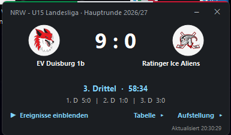

# NRW_Hockey_LiveTicker

Live-Ticker für laufende Spiele im Eishockeyverband NRW – als Windows-Programm und als Android-App.

| | Windows | Android |
|---|---|---|
| Name | EHV-NRW Live-Ticker | EHV Live |
| Version | 3.1 | 2.7 |
| Download | [EXE v3.1](https://cappy0815.github.io/downloads/EHV_NRW_LiveTicker_v3.1.exe) | [APK v2.7](https://cappy0815.github.io/downloads/EHV-Live-v2.7.apk) |



## Funktionen

- Laufende und heute noch anstehende Spiele aller NRW-Ligen, eigene Teams farbig hervorgehoben
- Ticker je Spiel: Stand, Spielzeit, Drittelergebnisse, Tore und Strafen mit Vorlagen
- Spielplan (nächste 7 Tage), Ergebnisse (letzte 7 Tage), „Meine Spiele“
- Steckbrief mit Halle, Route und Kalendereintrag, Ligatabelle, Aufstellung beider Teams
- Sparsam: abgefragt werden nur Ligen, die heute spielen; der Spielplan wird höchstens alle 30 Minuten geladen

**Windows:** rahmenlose, verschiebbare Ticker-Fenster (bis zu 8), Töne für Tor, Strafe, Drittelende, Spielende und Bully, Schiedsrichter-Einteilung (HSR und (L)SR) aus esrw.de unter dem Stand.  
**Android:** Reiter Live · Spielplan · Meine · Tabellen (wischen zum Wechseln), schwebendes Floating-Display über anderen Apps, Benachrichtigung mit Stand, Vibration, Display-Wecker über dem Sperrbildschirm, Schiedsrichter-Einteilung im Ticker (aus esrw.de), Update-Prüfung (einmal am Tag, abschaltbar; installiert wird nichts automatisch).

## Installation

**Windows 10/11:** EXE herunterladen und starten, keine Installation nötig. Das Programm ist nicht signiert, daher zeigt Windows beim ersten Start „Der Computer wurde durch Windows geschützt“ → *Weitere Informationen* → *Trotzdem ausführen*. Einstellungen liegen unter `%APPDATA%\EHV-Live-Ticker`.

**Android 8.0 oder neuer:** APK herunterladen und öffnen; Installationen aus dieser Quelle einmal erlauben. Für das Floating-Display braucht die App die Berechtigung „Über anderen Apps einblenden“.

Prüfsummen (SHA-256) stehen auf [cappy0815.github.io](https://cappy0815.github.io).

## Quellcode

- `android/` – Android-App (Java, Build ohne Gradle über `build.sh`)
- `windows/` – Windows-Programm (Go, nur Standardbibliothek, ohne Fremdpakete)

### Windows selbst bauen

Go ab 1.24 und Python 3. Im Ordner `windows/`:

```
python3 mkres.py 3.1.0.0 ehv_ticker.ico
GOOS=windows GOARCH=amd64 go build -trimpath -ldflags "-H windowsgui" -o EHV_NRW_LiveTicker.exe .
```

`mkres.py` erzeugt Versionsinfo, Manifest und Icon als Ressource für den Linker (ohne rc.exe).
## Updates

Beide Programme prüfen einmal am Tag, ob es eine neue Version gibt (abschaltbar in den Optionen). Ist eine neue da, erscheint ein Knopf „Update“, der die Download-Seite öffnet – installiert wird nichts automatisch.

- Android liest die Versionsdatei [`downloads/ehv-live.json`](https://cappy0815.github.io/downloads/ehv-live.json)
- Windows liest [`downloads/ehv-live-win.json`](https://cappy0815.github.io/downloads/ehv-live-win.json)

Als Rückfall dient jeweils das neueste Release dieses Repos (Windows: Tag `WIN_v…`, Android: `APK_v…`). Gesendet wird nur eine normale Abfrage mit der Versionsnummer, keine Daten aus dem Programm.

## Hinweis

Inoffizielles, privates Projekt ohne Verbindung zum Eishockeyverband NRW (EHV NRW) oder zu hockeydata.net. Angezeigt werden ausschließlich öffentlich zugängliche Spieldaten, wie sie auch auf ehv-nrw.de zu sehen sind, sowie die öffentlichen Schiedsrichter-Einteilungen von esrw.de (kein Bezug zu den Eishockey-Schiedsrichtern im Westen e.V.).

**Nur für die private Nutzung.** App und angezeigte Daten dürfen nicht für öffentliche Vorführungen, Übertragungen, Websites oder kommerzielle Zwecke verwendet werden.

Ohne Gewähr, kein Support.

Gebaut von Justus Jonas & MCHLNWK · [cappy0815.github.io](https://cappy0815.github.io)
